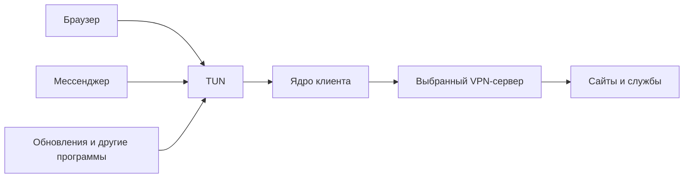
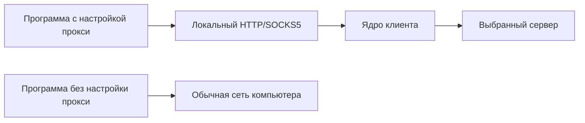
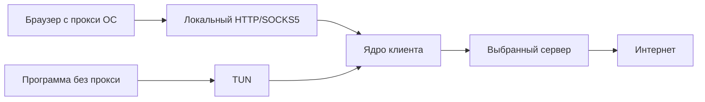

# Как работает сеть в Private Gateway

Здесь разобраны названия режимов, путь соединения и отличия Windows, macOS, Linux, Android и iOS.
Для установки и первого подключения — [руководство](guide.md); для проверки на своем устройстве —
[проверки Windows](../testing/windows-check.md), [Android](../testing/android-check.md) и
[iOS](../testing/ios-check.md).

Документ описывает код проекта. Доработки совместной работы TUN и системного прокси, пользовательского прокси Windows
и статуса виртуальных машин проверяются в ветке разработки. Состояние проверки вынесено в
[отдельный раздел](#12-что-реализовано-и-что-нужно-проверять). Само наличие функции в исходниках не означает, что она уже
попала в установленную программу или проверена на конкретном устройстве.

## 1. Из чего состоит подключение

Когда браузер открывает сайт, участвуют несколько разных механизмов:

| Понятие | Что означает | Пример |
| --- | --- | --- |
| Домен | Имя сайта или сервера | `example.com` |
| DNS | Поиск IP-адреса по имени | Узнать, куда соединяться для `example.com` |
| IP-адрес | Адрес узла в сети | `203.0.113.20` — вымышленный адрес для документации |
| Порт | Номер службы на этом адресе | HTTPS обычно использует TCP 443; VPN может работать на другом порту |
| Маршрут | Выбор следующего интерфейса или шлюза для пакета | Через Wi-Fi либо через виртуальный адаптер VPN |
| TUN | Виртуальный сетевой адаптер, из которого VPN получает IP-пакеты | Приложение работает как обычно, а ОС передает его пакеты в туннель |
| Прокси | Посредник, к которому программа сама обращается за соединением | HTTP или SOCKS5 на локальном порту клиента |
| Системный прокси | Настройка ОС, сообщающая программам адрес прокси | Браузер читает настройку Windows и обращается к клиенту |
| Ядро | Компонент, который выполняет сетевую часть подключения | Xray-core; на десктопе sing-box также принимает пакеты TUN |
| Брандмауэр | Правила, разрешающие или запрещающие передачу | Запретить выход вне туннеля при потере VPN |
| Блок при обрыве | Политика сохранения блокировки, когда VPN перестал работать | Пока идет переподключение, запросы ждут или получают ошибку |

TCP передает поток данных с контролем доставки, UDP — отдельные датаграммы. HTTPS обычно работает поверх TCP,
а HTTP/3, игры и звонки часто используют UDP. Поддержка HTTP-прокси в программе не означает, что она направит через
него и UDP. У SOCKS5 для UDP нужны поддержка программы и совместимость с ядром. ICMP, который использует обычный
`ping`, — отдельный протокол: успешный или неуспешный `ping` не заменяет проверку открытия сайта.

`127.0.0.1` означает этот же компьютер. Например, `127.0.0.1:10808` — локальный вход клиента, а не адрес VPN-сервера.
Адрес виртуального адаптера тоже внутренний: он нужен ОС для маршрутов. Сайт видит внешний адрес выхода сервера,
а не локальный адрес компьютера и не адрес TUN.

На одном IP могут работать разные службы. Если транспорт VPN использует `203.0.113.20:8444`, а панель —
`203.0.113.20:8443`, совпадение IP не делает их одним соединением. Важны также порт и транспорт.

## 2. Два независимых вопроса о режиме

Названия на экране другого клиента могут смешивать два вопроса: как приложение попадает в клиент и куда клиент
направляет его соединение. В Private Gateway они настраиваются отдельно.

| Вопрос | Настройка десктопа | Что выбирается |
| --- | --- | --- |
| Как передавать соединения в клиент? | «Настройки → Режим» | «VPN · вся система» или «Только прокси» |
| Куда направлять принятые соединения? | «Настройки → Маршрутизация» | «Весь трафик» или «Раздельный режим», правила сайтов |
| Сообщить ли программам адрес локального прокси? | «Настройки → Подключение и ядро → Системный прокси» | Применить настройку прокси ОС на время работы |

Системный прокси сохраняется отдельно для двух режимов: в «Только прокси» он включен по умолчанию, а для
«VPN · вся система» совместная работа включается явно и по умолчанию выключена. Обновление старой настройки
прокси-режима не должно само перенаправлять программы пользователя на новый вход VPN-режима.

Поэтому «TUN» и «Глобальный» — не взаимоисключающие режимы. Можно перехватывать пакеты через TUN и направлять весь
принятый трафик через выбранный сервер. Можно использовать тот же TUN, но разрешить выбранной программе прямой выход.

| Название в разговоре | Название и поведение в Private Gateway |
| --- | --- |
| TUN-режим, VPN для всей системы | «VPN · вся система»: ОС направляет соединения обычных программ в виртуальный адаптер |
| Глобальный режим | Ближайший аналог — «Маршрутизация → Весь трафик»: пользовательские прямые исключения не применяются |
| Правила | Правила сайтов; для прямых исключений и списка программ — «Раздельный режим» |
| Напрямую | Действие правила или исключение программы: использовать обычный выход в интернет без VPN-сервера |
| Системный прокси | Настройка ОС на локальный прокси клиента; ее используют только программы, учитывающие такую настройку |

Отдельного общего режима «Все напрямую» при работающем ядре в десктопе нет. Ручное отключение защиты возвращает
прямую сеть, если не включен «Строгий режим»: при нем сеть остается закрытой и после ручного отключения VPN.
Слово «Глобальный» здесь служит для сравнения с другими клиентами. В интерфейсе используется «Весь трафик»;
блокирующие правила сайтов сохраняются и в этом режиме.

## 3. TUN: VPN для всей системы

В режиме «VPN · вся система» программа не обязана поддерживать прокси. Она создает обычное соединение,
ОС выбирает маршрут в TUN, а ядро отправляет данные через выбранный сервер.

На десктопе пакеты TUN принимает sing-box, затем передает соединения Xray по защищенному локальному входу.
Xray применяет правила и протокол выбранного сервера. Android и iOS используют системный VPN и TUN-вход libXray
непосредственно, без отдельного процесса sing-box.

«Для всей системы» означает охват обычных сетевых программ хоста по маршрутам ОС. У контейнеров, виртуальных машин,
общего доступа к интернету и отдельных системных механизмов могут быть другие пути. Их защита рассматривается
отдельно в [разделе про виртуальные машины](#10-wsl2-hyper-v-и-контейнеры).

Одно подключение к выбранному серверу не означает один TCP-сокет для всех программ. У программ остаются собственные
соединения, а ядро может создавать несколько транспортных соединений к серверу. IPv4 и IPv6 выхода также могут иметь
разные публичные адреса. Изображение «один туннель — один IP» передает общий принцип, но не все детали.

## 4. Прокси и системный прокси

В режиме «Только прокси» ядро принимает соединения на локальном порту. По умолчанию это `127.0.0.1:10808`,
вход HTTP и SOCKS5. Программа может получить этот адрес из настроек ОС либо из своих собственных настроек.

Пример: браузер использует системный прокси, а игра его игнорирует. Браузер идет через клиент и выбранный сервер;
игра в режиме «Только прокси» продолжает использовать обычную сеть. Чтобы охватить обе программы без настройки
каждой, нужен TUN.

Системный прокси — рекомендация программам, а не перехват всего сетевого трафика. На Windows настройки прокси
пользователя не равны настройке WinHTTP для всех фоновых служб. Браузер, терминал, служба и приложение со своим
SOCKS5 могут использовать разные источники настроек. Программа с собственным прокси может обращаться к нему даже
при выключенном переключателе системного прокси.

Автоопределение прокси Windows (WPAD) и скрипт PAC — еще два источника настроек. Браузер может предпочесть их
ручному адресу клиента. Новый пользовательский контроллер Windows в этой ветке временно выключает их
при применении и возвращать вместе с прежним состоянием. Старый путь службы пользователя WPAD не меняет;
поэтому примененный ручной адрес нужно отличать от фактического маршрута программы. Предупреждение об
автоопределении видно в диагностике, если оно остается включенным.

Переключатель задает намерение применять прокси. Фактический результат нужно читать рядом: настройка применена,
ожидает подключения либо произошла ошибка. Запущенное ядро и сохраненная настройка сами по себе не доказывают,
что Windows или другая ОС уже направляет программы на этот вход.

| Подпись возле переключателя | Как ее понимать |
| --- | --- |
| «Включится после готовности локального прокси» | Настройка сохранена, но подтвержденного входа службы еще нет |
| «Применен: 127.0.0.1:…» | Пользовательские настройки прочитаны после изменения и совпали с ожидаемыми |
| «Сохранен: 127.0.0.1:… · ожидание восстановления VPN» | Прежний локальный адрес остается в ОС во время сбоя; браузер должен ожидать вход, а не переключаться напрямую |
| «Прежние настройки восстановлены» | Снимок успешно возвращен и результат прочитан из ОС |
| «Настройки изменила другая программа — ее настройки сохранены» | Клиент обнаружил потерю владения настройкой и не перезаписывает ее |
| «Прокси настраивает служба; применение здесь не подтверждено» | Управление осталось у службы; оконный контроллер не объявляет его проверенным |
| «Служба не поддерживает автоматическую настройку этого режима» | В том числе старая служба без подтверждения нужной возможности; порт из настроек не подставляется наугад |
| «Не удалось изменить настройки системного прокси» | ОС или работа со снимком вернули ошибку; успешное применение не подтверждено |

При применении сохраняются прежние настройки. После отключения защиты возвращается прежнее состояние, включая
предыдущий адрес прокси, если он был. Вмешательство другой программы требует отдельной обработки: возврат снимка
не должен молча затирать более новые чужие настройки. После аварии восстановление зависит от сохраненного снимка
и следующего запуска управляющего компонента.

В Windows при установленной SYSTEM-службе пользовательским прокси управляет компонент приложения в контексте
вошедшего пользователя. Служба сообщает фактический порт готового входа; старой службе без такого входа нельзя
молча приписать готовый прокси по номеру из настройки. Во время переподключения или ошибки примененный прокси
сохраняется на прежнем входе, чтобы программы ожидали восстановления. Пауза для входа в Wi-Fi, ручное отключение
защиты и выключение опции возвращают прежнее состояние. Выход из процесса окна сам по себе не означает остановку
работающей установленной службы: настройка и снимок сохраняются. Прежние настройки возвращает окно при следующем
запуске: с автозапуском оно стартует при входе в Windows само, а без автозапуска, пока окно держит прокси, Windows
один раз запускает его при следующем входе (запись `RunOnce`, решение 534) — только значком в трее. Защита к этому
времени выключена — окно возвращает прежние настройки, и браузеры не остаются на неработающем 127.0.0.1. Свернутое в
трей окно продолжает работать и управлять настройкой.
Снимок запоминает тип службы: после аварии окна пользовательская служба запускается для подтверждения отключенного
состояния и возврата настроек, а снимок установленной службы ожидает ее собственного достоверного состояния.
При штатном выходе окна с пользовательской службой настройки возвращаются сразу; работающая установленная служба
продолжает VPN и прокси после выхода окна.

Блока при обрыве для всей машины в режиме «Только прокси» нет. Программа, обращающаяся к недоступному локальному
прокси, обычно получит ошибку соединения; поведение программы с собственным прямым запасным путем определяет она сама.

## 5. TUN и системный прокси вместе

Совместная работа дает два входа в один клиент: программы, учитывающие системный прокси, обращаются к локальному
HTTP/SOCKS5; остальные попадают в TUN по маршрутам ОС. Выбранный сервер остается общим.

Для десктопа это комбинация «VPN · вся система» и включенного «Системного прокси» в «Подключении и ядре».
Ее реализация и проверка относятся к текущей ветке доработок. Для обычного охвата программ работающего TUN уже
достаточно; совместная работа нужна, например, чтобы программа продолжала пользоваться своим настроенным SOCKS5.
Второго VPN-перехода или дополнительного слоя VPN-шифрования от этой комбинации не появляется.

Счетчики скорости и трафика на главной в режиме VPN сейчас берутся с TUN-адаптера. Соединения, принятые напрямую
через локальный HTTP/SOCKS5, могут обходить этот адаптер и в сумму не входить. Поэтому при совместной работе нулевая
или небольшая скорость TUN не означает, что программа с прокси перестала передавать данные через сервер.
Общая метрика обоих входов требует отдельной реализации и проверки.

Наличие локального входа и автоматическое изменение настроек ОС — разные возможности. На Windows для этого
дорабатывается пользовательский контроллер; на macOS настройки меняет установленная служба. На Linux с root-службой
пользовательский прокси GNOME/KDE автоматически не применяется: программу можно направить на локальный вход вручную.

Исходящие соединения самого ядра должны достигать сервера по внешнему интерфейсу, иначе они вернутся в собственный
TUN по кругу. Поэтому клиент отдельно направляет транспортное соединение к серверу. Это служебное правило,
а не разрешение всем программам ходить мимо VPN.

Правила сайтов можно применять в Xray на обоих входах. Исключение программы по пути ее процесса работает на TUN,
который определяет исходную программу. У прямого HTTP/SOCKS5-входа Xray такой привязки к исходному процессу нет:
программа, сама использующая локальный прокси, не должна считаться исключенной только потому, что ее путь есть
в списке обхода TUN. Для прямого сайта используют правило сайта, а совместимость каждого пути проверяют отдельно.

## 6. «Весь трафик», правила и прямые исключения

В «Весь трафик» обычный маршрут принятых соединений — выбранный VPN-сервер. Список программ мимо VPN и правила
сайтов «Напрямую» не применяются. Правила «Блокировать» и «Через VPN» сохраняются. Разрешенная локальная сеть,
свой DNS в локальной сети и соединение самого клиента с VPN-сервером — отдельные настройки и служебные исключения.

В «Раздельном режиме» можно выбрать программы мимо VPN и задать правила сайтов. Программа в таком списке идет
напрямую целиком; правило сайта относится только к совпавшему адресу или имени.

| Настройка | Пример результата |
| --- | --- |
| Игра добавлена в «Программы мимо VPN» | Сервер игры видит внешний IP обычного подключения; остальные программы идут через VPN |
| Для `example.com` задано «Напрямую» | Этот сайт и совпавшие поддомены идут напрямую; другие сайты того же браузера следуют остальным правилам |
| Для сайта задано «Блокировать» | Соединение к совпавшему сайту запрещено, а не перенаправлено в другую сеть |
| Выбран «Весь трафик» | Пользовательские прямые исключения отключены; список сохраняется для последующего возврата в раздельный режим |

Правила принимают домен, `*.домен`, категорию `geosite:…`, IP или подсеть. Правила имен проверяются по имени;
правила адресов — по IP. Сайт может загружать изображения, видео и вход в аккаунт с других доменов: одно правило
не обязано охватывать все эти дополнительные службы. Порядок и совпадение правил важны; подробности —
[конфиг Xray](../architecture/core.md#что-в-конфиге).

Прямое исключение сознательно разрешает обычный выход в интернет. Соответствующий сайт может видеть внешний IP
провайдера; блок при обрыве не дает такому исключению обещания «только через VPN». Поэтому в интерфейсе раздельного
режима есть предупреждение, а проверка «Весь трафик» показывает частичный охват при действующих исключениях.

### Почему порт VPN идет напрямую, а панель на том же IP — через VPN

Для связи с `203.0.113.20:8444` самому VPN нужен внешний путь. Прямое служебное правило сопоставляет IP и порт
активного профиля. Панель `203.0.113.20:8443` остается в TUN и идет через сервер; порт 8444 другого IP также идет
по обычным правилам. При полном совпадении IP и порта сайта с транспортом VPN эта пара остается прямым исключением.
История исправления — [в руководстве](guide.md#панель-на-ip-vpn-сервера-что-изменили).

## 7. DNS, IPv6 и локальная сеть

На настольном клиенте выбор **«По умолчанию: Cloudflare»** означает Cloudflare DoH. В старых сохраненных настройках
он по-прежнему называется `Profile`; это совместимое имя значения, а не обещание прочитать DNS из списка серверов.
Quad9 и пользовательский адрес выбираются отдельно. Настройка показывает желаемый выбор; состояние действующей
защиты и результат отдельной пробы показываются рядом независимо от него.

Прямая DNS-проба ищет ответ на IPv4 UDP/53 через внешний адаптер. Получен проверенный ответ — обнаружен открытый
путь вне туннеля. Ответ не получен — замер не подтвержден: причиной могут быть фильтры, недоступный резолвер или
ошибка сети. Это не означает успешную проверку всех DoH/DoT-запросов браузера. Состояние примененных правил при этом
не подменяется результатом пробы. Несколько адресов Cloudflare или Quad9 могут относиться к одному сервису.

В режиме «Только прокси» DNS ядра относится к обслуживаемым им соединениям; DNS всей ОС этот режим не перехватывает.
Собственный DoH браузера выбирает свой резолвер; при полном VPN его HTTPS-трафик обычно также идет в туннеле.
FakeDNS возвращает синтетические адреса локально, но не отменяет последующее разрешение имен на выходе.

DNS нужен дважды: сначала для поиска адреса самого VPN-сервера, затем для сайтов внутри работающего подключения.
До поднятия VPN клиент использует доступный разрешитель; при работающем VPN DNS программ направляется к DNS
туннеля и далее через ядро. При блокировке без туннеля поиск нового сервера использует ограниченный служебный путь.
Такая подготовка отличается от отправки DNS сайтов напрямую провайдеру.

По умолчанию используются DNS ядра и DoH. В «Защите и утечках» можно выбрать Cloudflare, Quad9 или свой адрес.
Свой DNS в частной сети, например домашний Pi-hole, запрашивается напрямую: VPN-сервер в интернете до домашнего
адреса не доберется. В этом случае DNS виден выбранному локальному разрешителю — это должно быть показано
как отдельная настройка, а не как полностью скрытый DNS. Собственный DoH программы следует маршрутам ее соединения.

IPv4 и IPv6 — два семейства адресов. Если защитить только IPv4 и оставить IPv6 без контроля, часть соединений
сможет использовать другой путь. Клиент либо передает IPv6 через сервер, либо закрывает его согласно настройкам
и возможностям ОС; точные механизмы по платформам приведены ниже. Неуспешная проверка IPv6 сервера не доказывает,
что сервер выключен целиком: IPv4 может продолжать работать.

«Разрешить локальную сеть» открывает доступ к устройствам рядом: принтеру, домашнему серверу, роутеру.
Локальная сеть при этом видит такие соединения. Это отдельное осознанное исключение из полного туннеля.
В VPN-пути клиента доступ к локальной сети по умолчанию закрыт. Режим «Только прокси» не ограничивает обычные
прямые соединения компьютера: в настройках прокси ОС локальные адреса также могут быть в списке обхода.
Обнаружение устройств, например mDNS, настраивается отдельно там, где оно доступно.

## 8. Блок при обрыве и переподключение

Маршрут показывает предпочтительный путь, а брандмауэр запрещает нежелательные пути. Для защиты при сбое нужны оба.
На десктопе правила ставит привилегированная служба до запуска TUN. При потере ядра или связи клиент меняет
политику на блокировку без туннеля и переподключается к тому же выбранному серверу.

Выключенный «Блок при обрыве» определяет поведение во время обрыва: сеть может открыться напрямую. Пока VPN
подключен, правила «только туннель» все равно ограничивают обход активного TUN. Поэтому выключение этого
переключателя не означает снятие всех сетевых фильтров работающего VPN.

«Строгий режим» десктопа сохраняет блок и после ручного отключения. «Защита при загрузке» отвечает за восстановление
блокировки при запуске машины. Пауза «Вход в Wi-Fi» временно открывает обычную сеть для страницы авторизации;
это намеренное разрешенное окно с показанным временем.

Уведомление «Соединение потеряно» означает переход из подключенного состояния к переподключению. Причиной может
быть завершение ядра или две подряд неудачные проверки через VPN. Проверка зависит от пути до проверочного сайта,
поэтому такое уведомление само по себе не доказывает остановку VPN-сервера. Ошибка создания адаптера при следующем
запуске — отдельный этап восстановления, ее нужно читать отдельно от причины первоначального обрыва.

## 9. Что отличается между операционными системами

| ОС | Как программы попадают в VPN | Ядра в текущем проекте | Кто ограничивает обход | Системный прокси |
| --- | --- | --- | --- | --- |
| Windows | TUN-адаптер `Private Gateway`, маршруты sing-box | Xray и отдельный sing-box | WFP; для части виртуальных сетей нужен отдельный брандмауэр Hyper-V | Настройка текущего пользователя; автоматическое применение при SYSTEM-службе дорабатывается в этой ветке |
| macOS | Интерфейс `utun225`, маршруты sing-box | Xray и отдельный sing-box | Правила pf в собственном якоре | Настройки сетевых служб через `networksetup`, применяет установленная служба root |
| Linux | Интерфейс `pgtun0`, правила и отдельная таблица маршрутов | Xray и отдельный sing-box | nftables для исходящих и пересылаемых пакетов | Пользовательский сеанс KDE Plasma или GNOME; другие окружения автоматически не обещаются |
| Android | Системный `VpnService`, дескриптор TUN | libXray внутри службы приложения | Системная блокировка Android без VPN; приложение сохраняет TUN во время восстановления | Общего режима системного прокси и переключателя «Только прокси» в приложении нет |
| iOS | Network Extension, `NEPacketTunnelProvider`, дескриптор `utun` | libXray внутри расширения | Системная политика профиля `includeAllNetworks`, пока VPN включен или поднимается | Десктопного режима «Только прокси» и переключателя системного прокси нет |

### Windows

Установленная служба работает от SYSTEM и управляет TUN, маршрутами и фильтрами Windows Filtering Platform.
Окно работает от вошедшего пользователя. Учетная запись службы и пользовательские настройки прокси — разные
контексты; запись прокси для SYSTEM не перенастроит браузер вошедшего человека. Именно поэтому пользовательский
прокси нужно применять в правильном контексте и подтверждать результат отдельно от готовности ядра.

WFP ограничивает соединения IPv4 и IPv6, разрешает транспорт к выбранному серверу и согласованные исключения.
До готовности TUN разрешения адаптеру нет. После обрыва его убирают. sing-box управляет адресом и DNS TUN;
ядро не должно оставлять старый адаптер после завершения. При аварийном завершении остатки проверяются перед новым
запуском. Повторное подключение и восстановление адаптера проверяются на настоящей Windows.

### macOS

Привилегированная служба создает путь через sing-box и `utun`, направляет DNS сетевых служб на DNS туннеля и
использует pf для блокировки. Прежние DNS и настройки прокси сохраняются и возвращаются после окончания работы
или при восстановлении после сбоя. Правила pf размещены в собственном якоре; состояние чужих правил не должно
считаться подтверждением нашей защиты.

Системный прокси здесь относится к сетевым службам, например Wi-Fi, и меняется через `networksetup` от root.
Это отличается от пользовательского HKCU Windows. Проверка отдельного якоря pf в CI и проверка всего трафика
на личном Mac — разные уровни проверки.

### Linux

Служба root создает `pgtun0`; sing-box выбирает маршруты через отдельную таблицу. Маршруты охватывают IPv4 и,
когда разрешено, IPv6. Метки сокетов отличают разрешенный прямой выход ядра и служебный поиск сервера от пакетов
обычных программ. nftables ограничивает как исходящие пакеты машины, так и пересылку через нее.

DNS ОС направляется в DNS туннеля; в окружениях с systemd-resolved адрес DNS связан с интерфейсом. Запрос программы,
привязанный к физической карте, может обходить обычный выбор маршрута, поэтому одного TUN недостаточно:
правила брандмауэра закрывают DNS и другие запрещенные прямые пути. Окружения Linux и сетевые менеджеры различаются,
поэтому результат проверяют на конкретной системе.

Автоматический системный прокси реализован для пользовательских сеансов KDE Plasma и GNOME. Переменные
`HTTP_PROXY`/`HTTPS_PROXY` терминала — другой механизм: настройка рабочего стола не обязана менять окружение уже
запущенного терминала. Прокси в терминале можно задать вручную либо использовать режим VPN.
Установленная root-служба Linux не меняет настройки прокси вошедшего пользователя. В отличие от новой доработки
Windows, отдельного оконного управляющего компонента для этого сценария Linux в текущей ветке нет.

### Android

Android выдает приложению разрешение на VPN и создает TUN через `VpnService`. libXray читает пакеты из дескриптора
этой карты. Сокеты самого ядра исключаются из собственного туннеля вызовом `protect`, иначе VPN пытался бы
дозваниваться до сервера через себя. При смене Wi-Fi и мобильной сети ядро получает DNS новой внешней сети.

Когда «IPv6 через сервер» выключено, приложение не разрешает семье IPv6 обход VPN: Android закрывает ее для
охваченных VPN программ. При включении создаются адрес и маршрут IPv6. Доступ к локальной сети регулирует
конфиг ядра. Поиск сайта и собственный DNS программы остаются сетевыми соединениями внутри выбранного пути.

Во время переподключения приложение сохраняет карту, чтобы пакеты ожидали новое ядро. Для защиты после
остановки или уничтожения приложения нужно включить в системных настройках Android «Постоянная VPN» и
«Блокировать подключения без VPN». Эти переключатели включает пользователь; наличие разрешения VPN само по себе
не включает блокировку. Фоновые ограничения производителя и смена сети проверяются отдельно на телефоне.

В текущем мобильном интерфейсе нет десктопных списков программ мимо VPN и пользовательских правил сайтов.
Клиент не использует список исключенных приложений Android для обычного подключения. В libXray этой версии
нет подключений Hysteria2/TUIC; на десктопе они доступны через отдельный ретранслятор sing-box.

### iOS

iOS запускает отдельное расширение Packet Tunnel по сохраненному VPN-профилю. Оно получает пакеты `utun` и
передает их libXray. Собственные соединения расширения ОС выводит из его туннеля. В профиль не записывается
реальный адрес VPN-сервера: он читается расширением из защищенного хранилища приложения.

Маршруты IPv4 и IPv6 направляются в туннель всегда. Если передача IPv6 через сервер выключена, ядро блокирует
IPv6, а DNS отвечает адресами IPv4. Оставить IPv6 вообще без маршрута было бы недостаточно для iOS.

Блок при обрыве — свойство профиля `includeAllNetworks`: пока профиль подключен или поднимается, ОС ограничивает
выход вне него. При разрешенной локальной сети используется `excludeLocalNetworks`; при закрытой локальной сети
маршруты и ядро закрывают доступ к ней. Ручное отключение VPN завершает действие этого блока. «Постоянная защита»
через On Demand просит iOS автоматически поднимать профиль после перезагрузки, смены сети и сбоя расширения;
это отдельная настройка, не десктопный постоянный фильтр WFP/nftables/pf.

Десктопных режимов «Только прокси» и пользовательского раздельного режима здесь нет. Доступность протоколов
определяет мобильный libXray: Hysteria2/TUIC отклоняются до запуска. Для настоящего туннеля нужны подпись приложения,
права Network Extension и проверка на iPhone; сборка симулятора не подтверждает сетевую защиту реального телефона.

## 10. WSL2, Hyper-V и контейнеры

Браузер Windows и Linux в WSL2 — разные источники трафика. Windows может пересылать пакеты виртуальной машины
через NAT или виртуальный коммутатор. Такие пакеты проходят другой путь, чем соединения обычной программы хоста.
Поэтому успешная проверка Chrome не подтверждает блокировку WSL2.

Пример проверки: при рабочем VPN запросы браузера и WSL2 проходят через сервер. Связь с VPN-сервером пропадает,
но защита остается включенной. Браузер прекращает получать ответы; если WSL2 продолжает обращаться к сайту через
провайдера, это обход блока. Само предупреждение о недоступном механизме такого факта не доказывает: нужна проба
из виртуальной машины во время сбоя. Ручное выключение защиты — другой сценарий и может законно открыть сеть.

На Windows фильтры пересылки WFP дополняются брандмауэром Hyper-V для поддерживаемых виртуальных сетей.
Этот механизм доступен в поддерживаемых конфигурациях Windows 11 22H2 и новее; наличие функции ОС, наличие правил
и результат реального запроса — отдельные факты. Внешний коммутатор Hyper-V, Windows Sandbox и контейнеры WinNAT
нельзя считать закрытыми только по проверке этих правил. На старой или неподдерживаемой конфигурации приложение
должно показывать ограничение, а не обещать защиту всех виртуальных машин.

Новый статус «Защита WSL2 и Hyper-V» показывает результат доступной проверки механизма. «Правила установлены»
означает, что найдены включенные блокирующие правила обоих направлений; одинаковых имен правил недостаточно.
Даже такой результат остается предупреждением о непроверенном трафике ВМ. При активном TUN статус тоже не
объявляет все виртуальные сети защищенными: путь конкретной ВМ через туннель еще нужно подтвердить.
Недоступный механизм, ошибка установки и отсутствующие правила отображаются отдельно.
Пока туннеля нет и оба правила подтверждены, они входят в проверку целостности блока: изменение или удаление
правила требует его восстановления. При поднятом TUN эти правила снимаются, а статус остается «Не проверено»
для фактического пути ВМ. Наличие и восстановление правил проверяются отдельно от реального запроса из ВМ.

Этот статус не означает, что клиент сам запустил каждую виртуальную машину и испытал ее сеть. Для контейнеров,
отдельных коммутаторов и совместного доступа нужен свой сценарий проверки. На Linux правила пересылки ограничивает
nftables, на macOS — pf; особые виртуальные сети и мосты также требуют проверки на своей конфигурации.

## 11. Как понимать проверку и отчет

«Защищено» относится к текущему состоянию соединения. Строки проверки уточняют, что известно про ядро,
маршруты, блокировку, DNS, IPv6 и внешний IP. Например, «IP скрыт» — измерение ответа проверочного сайта,
а не доказательство пути всех процессов и виртуальных машин. «Нет утечек DNS» — результат конкретной проверки,
а не обещание любых вариантов работы на любой ОС.

Для разбора проблемы нужны время события, режим, состояние защиты, сборки окна и службы и журнал рядом с событием.
Версия `0.1.0` без номера сборки не различает все изменения исходников. Снимок проверки и журнал могут относиться
к разным моментам: восстановившееся состояние не отменяет предыдущую ошибку.
«Проверено» — время последней проверки, а версии окна и службы запрашиваются для текущего экспорта.
Исторические строки журнала могли появиться до обновления службы; текущий коммит сам по себе не датирует старую ошибку.

В «Проверке» можно посмотреть внешний IP, сеть до и после VPN, DNS, TCP/TLS, задержку и журнал, затем экспортировать
обезличенный отчет. Прямой пинг до сервера, запрос через уже открытое соединение и открытие нового соединения —
разные измерения: низкий пинг не исключает долгого создания нового HTTPS-сеанса.

Для самостоятельной проверки сначала выбирают конкретный сценарий: обычные программы хоста, системный прокси,
DNS, IPv6 или виртуальная машина. Проверяют рабочее подключение, потерю связи, переподключение и ручное отключение
с учетом строгого режима. Сценарии с брандмауэром и остановкой ядра выполняют на стенде либо по отдельной инструкции,
чтобы не перепутать намеренное открытие сети с обходом включенной защиты.

## 12. Что реализовано и что нужно проверять

| Возможность | Состояние в проекте | Что подтверждает работу на устройстве |
| --- | --- | --- |
| TUN десктопа, правила сайтов, прямые исключения | Реализованы; основные механизмы описаны выше | Проверки конкретной ОС и тесты соединений через настоящий TUN |
| Другие порты IP VPN-сервера — через туннель, соединение ядра с сервером — мимо него | Реализовано, CI трех ОС зеленый (решения 512, 533) | Панель на том же IP открывается при VPN; скорость VPN не ниже, чем до 2026-11-01 |
| TUN вместе с локальным HTTP/SOCKS5 и системным прокси | Реализовано, CI трех ОС зеленый | Оба входа ведут через выбранный сервер; правила, восстановление и блок при обрыве проверены отдельно |
| Прокси текущего пользователя Windows при установленной службе | Реализовано; включение, сверка и возврат — тест на настоящей Windows в CI (решения 516, 534) | Браузер идет через прокси, после «Выключить» настройки прежние; после перезагрузки без автозапуска окно возвращает их само |
| Статус защиты WSL2/Hyper-V | Реализован; область проверки ограничена механизмом ОС | Запросы из нужной ВМ во время обрыва и восстановления, а не только наличие фильтров |
| Android VPN | Реализованы VpnService, libXray, системные настройки блокировки; есть проверки эмулятора | Проверка конкретного телефона, сна, смены сети и системной блокировки без VPN |
| iOS VPN | Реализованы профиль и расширение, сборка и проверки логики в CI | Подписанная сборка с правами и настоящий туннель на iPhone |

Новый коммит проверяется локальными тестами и CI на поддерживаемых ОС. Системные тесты, пропущенные из-за отсутствия
прав, устройства или другой ОС, не считаются пройденными. Короткий цикл переподключений не заменяет полный длительный
прогон. Результаты конкретной ветки и открытые проверки ведутся в [ROADMAP](../../README.md#15-этап-11--стабилизация-и-выпуск).

Технические подробности и указатели на код — [архитектура сети](../architecture/network.md),
[служба](../architecture/service.md), [ядра](../architecture/core.md), [блок при обрыве](../architecture/kill-switch.md),
[Android](../architecture/android.md), [iOS](../architecture/ios.md) и [модель угроз](../security/threat-model.md).

Тесты в CI не заменяют проверку на устройстве: трафик виртуальных машин при обрыве и долгий прогон на машине пользователя
по-прежнему проверяются отдельно (ROADMAP, этап 11).
